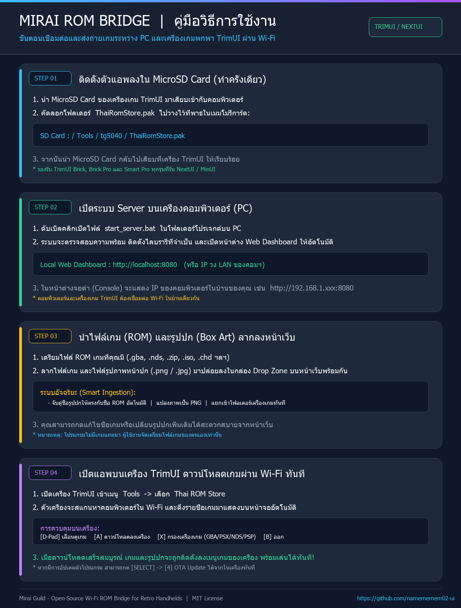

# Mee-a-rai RomStore 🎮
### Wireless LAN ROM Bridge & Sync Utility for Retro Handhelds (TrimUI / NextUI)

[](LICENSE)
[-emerald)](https://github.com/namememem02-ui/Mee-a-rai-RomStore)
[](https://github.com/namememem02-ui/Mee-a-rai-RomStore)
[](https://github.com/namememem02-ui/Mee-a-rai-RomStore)

**Mee-a-rai RomStore** (formerly *Mirai ROM Bridge*) เป็นโปรแกรมอำนวยความสะดวกในการจัดเก็บ บริหาร และส่งถ่ายไฟล์เกมสำรอง (Game Backups) และรูปภาพหน้าปก (Box Art) ระหว่างคอมพิวเตอร์ (PC) กับเครื่องเกมพกพาตระกูล **TrimUI** (เช่น **TrimUI Brick, Brick Pro, Smart Pro**) ผ่านระบบเครือข่ายไร้สาย (Wi-Fi ภายในบ้าน) โดยไม่ต้องถอดการ์ด MicroSD Card เข้าๆ ออกๆ อีกต่อไป

---

## ⬇️ ดาวน์โหลดโปรแกรมพร้อมใช้งาน (Direct Downloads)

| แพ็กเกจ | ไฟล์ดาวน์โหลด | รายละเอียด |
| :--- | :--- | :--- |
| 📦 **ชุดรวมสมบูรณ์ (แนะนำ)** | [**Mee-a-rai-RomStore-v1.2.6-Complete.zip**](https://github.com/namememem02-ui/Mee-a-rai-RomStore/releases/download/v1.2.6/Mee-a-rai-RomStore-v1.2.6-Complete.zip) | รวมฝั่ง PC (start_server.bat) + ฝั่งเครื่องเกม + ภาพคู่มือ ใช้งานได้ทันที |
| 🎮 **เฉพาะแอพลงเครื่องเกม** | [**ThaiRomStore-TrimUI-v1.2.6.zip**](https://github.com/namememem02-ui/Mee-a-rai-RomStore/releases/download/v1.2.6/ThaiRomStore-TrimUI-v1.2.6.zip) | แตกไฟล์แล้วก๊อปปี้โฟลเดอร์ Tools ลง MicroSD Card ได้ทันที |

👉 หรือเลือกดูเวอร์ชันทั้งหมดได้ที่: [**GitHub Releases**](https://github.com/namememem02-ui/Mee-a-rai-RomStore/releases)

---

## 📖 คู่มือสรุปขั้นตอนการใช้งาน (Visual Guide)



---

## ✨ จุดเด่นและความสามารถ (Key Features)

* 📶 **โอนถ่ายเกมไร้สาย 100%:** จัดการเกมบนคอมพิวเตอร์แล้วกดดาวน์โหลดเข้าเครื่องเกมได้ทันทีผ่านวง Wi-Fi เดียวกัน
* 🖥️ **Smart Web Dashboard บน PC:** มีระบบหน้าเว็บลากวาง (Drag & Drop) จัดการเกม แปลงรูปภาพปกเป็น PNG และจับคู่ชื่อไฟล์ให้ตรงกับชื่อ ROM อัตโนมัติ
* ⚡ **Native Framebuffer C Client:** ตัวแอพบนเครื่อง TrimUI เขียนด้วยภาษา C ทำงานบน `/dev/fb0` และ Linux evdev โดยตรง ทำงานลื่นไหล รวดเร็ว ไม่กินทรัพยากร
* 🎯 **ระบบกรองเครื่องเกมแม่นยำ (Strict Filtering):** แยกหมวดเครื่องเกมชัดเจน `GBA`, `NDS`, `PSX (PlayStation 1)`, `PSP`, `SFC` ไม่มีปัญหาเกม PSP ปนเข้าหมวด PSX
* 🇹🇭 **รองรับภาษาไทยคมชัด & ป้องกันฟอนต์สี่เหลี่ยม (Tofu Guard):** แสดงผลชื่อเกมภาษาไทยได้คมชัด และมีระบบป้องกันตัวอักษรกลวงสี่เหลี่ยม (`.notdef`) 100% พร้อมวาดธงไตรรงค์ไทยแท้ระดับพิกเซล
* 🔄 **ระบบอัปเดตตัวแอพในเครื่องผ่าน Wi-Fi (In-App OTA Update):** เมื่อมีเวอร์ชันใหม่ สามารถกดอัปเดตผ่านเมนู `[SELECT]` บนตัวเครื่องได้ทันที ไม่ต้องถอดการ์ดมาลงใหม่

---

## 🚀 วิธีการติดตั้งและใช้งาน (Quick Start)

### ขั้นตอนที่ 1: ติดตั้งตัวแอพลง MicroSD Card (ทำครั้งเดียว)
1. นำ MicroSD Card ของเครื่องเกมมาเสียบเข้าคอมพิวเตอร์
2. คัดลอกโฟลเดอร์ `client_pak/ThaiRomStore.pak`
3. ไปวางไว้ที่:
   ```text
   [MicroSD Card]/Tools/tg5040/ThaiRomStore.pak
   ```
4. นำ MicroSD Card เสียบกลับเข้าเครื่องเกม TrimUI

### ขั้นตอนที่ 2: เปิด Server บนคอมพิวเตอร์
1. ตรวจสอบว่าในเครื่องคอมพิวเตอร์มี **Python 3.8+**
2. ดับเบิ้ลคลิกไฟล์ **`start_server.bat`**
3. ระบบจะตรวจสอบความพร้อมและเด้งเปิดหน้าต่างเบราว์เซอร์ **Web Dashboard** (`http://localhost:8080`) ให้อัตโนมัติ

### ขั้นตอนที่ 3: เพิ่มเกมและรูปปก (Drag & Drop)
1. นำไฟล์ ROM เกมที่คุณมี (`.gba`, `.nds`, `.iso`, `.chd`, `.zip` ฯลฯ)
2. นำไฟล์ภาพหน้าปก (`.png`, `.jpg`)
3. ลากไฟล์ทั้งสองมาปล่อยลงในกล่อง **Drop Zone** บนหน้าเว็บพร้อมกัน ระบบจะจัดเก็บและจับคู่เข้าโฟลเดอร์เครื่องเกมให้อัตโนมัติ

### ขั้นตอนที่ 4: ดาวน์โหลดผ่าน Wi-Fi บนเครื่อง TrimUI
1. ตรวจสอบว่าเครื่อง TrimUI เชื่อมต่อ Wi-Fi วงเดียวกับคอมพิวเตอร์
2. เข้าเมนู **Tools** -> เลือก **`Thai ROM Store`**
3. ตัวเครื่องจะสแกนหาคอมพิวเตอร์ในบ้านอัตโนมัติ (Auto-Scan) และแสดงรายชื่อเกม
4. เลื่อนเลือกเกมแล้วกดปุ่ม **`[A]`** เพื่อดาวน์โหลดตัวเกมและรูปปกเข้าเครื่องได้ทันที!

---

## 🎮 การควบคุมบนเครื่อง TrimUI

| ปุ่ม | คำสั่ง | คำอธิบาย |
| :--- | :--- | :--- |
| **`[D-Pad]`** | เลื่อนเลือกเกม | เลื่อนขึ้น / ลง เพื่อเลือกเกมในรายการ |
| **`[A]`** | ยืนยัน / ดาวน์โหลด | สั่งดาวน์โหลดเกมที่เลือกและรูปปกลง SD Card |
| **`[B]` / `[MENU]`** | ออก | ปิดแอพและกลับสู่เมนูหลักของ NextUI |
| **`[X]`** | กรองเครื่องเกม | วนสลับหมวด: `ทั้งหมด` ➔ `GBA` ➔ `NDS` ➔ `PSX` ➔ `PSP` ➔ `SFC` |
| **`[Y]`** | รีเฟรช | ดึงรายชื่อเกมล่าสุดจากคอมพิวเตอร์ใหม่ |
| **`[SELECT]`** | เมนูตั้งค่า & OTA | ค้นหา IP อัตโนมัติ, ตั้งค่า IP ด้วยตัวเอง, หรือกดอัปเดตเวอร์ชันใหม่ (OTA) |

---

## 📁 โครงสร้างโปรเจกต์ (Project Structure)

```text
Mee-a-rai-RomStore/
├── client_pak/
│   └── ThaiRomStore.pak/           # โฟลเดอร์แอพสำหรับนำไปวางใน MicroSD Card เครื่องเกม
│       ├── bin/
│       │   ├── store.elf          # ไบนารี GUI Framebuffer ภาษา C (ARM64 Static)
│       │   ├── autoscan.sh        # สคริปต์ค้นหาคอมพิวเตอร์ในวง Wi-Fi
│       │   ├── curl               # ARM64 portable curl
│       │   └── show2.elf
│       ├── res/
│       │   └── font.ttf           # ฟอนต์ไทยความละเอียดสูง
│       ├── config.txt             # คอนฟิกการเชื่อมต่อ
│       ├── launch.sh              # สคริปต์เริ่มทำงานและระบบจัดการอัปเดต OTA
│       ├── icon.png
│       └── pak.json
│
├── static/                        # ไฟล์หน้าเว็บ Web Dashboard
│   ├── index.html                 # หน้าจัดการเกม Drag & Drop
│   ├── logo.png
│   └── favicon.ico
│
├── storage/                       # โฟลเดอร์เก็บไฟล์เกม (ผู้ใช้นำเกมของตนเองมาใส่)
│   └── Roms/
│       ├── Game Boy Advance (GBA)/
│       ├── Nintendo DS (NDS)/
│       ├── Sony PlayStation (PS)/
│       ├── Sony PlayStation Portable (PSP)/
│       └── ...
│
├── src/                           # ซอร์สโค้ดภาษา C (Open Source)
│   ├── mirai_store.c
│   ├── stb_image.h
│   └── stb_truetype.h
│
├── docs/                          # เอกสารและรูปภาพคู่มือ
│   └── how_to_use.png
│
├── server.py                      # REST API Server และตัวจัดการระบบ
├── start_server.bat               # ตัวรันเซิร์ฟเวอร์แบบ 1-Click บน Windows
├── requirements.txt
├── LICENSE
└── README.md
```

---

## ⚖️ ข้อสงวนสิทธิ์ทางกฎหมาย (Legal Disclaimer)

> **IMPORTANT NOTICE:**
> 
> This software is strictly a local-area network (LAN) convenience and file transfer utility designed for personal retro handheld devices. 
> 
> * **NO COPYRIGHTED MATERIAL:** This repository does **NOT** contain, distribute, host, or link to any copyrighted game ROMs, proprietary BIOS files, or commercial artwork.
> * **USER RESPONSIBILITY:** Users are solely responsible for providing and managing their own legally obtained game backups in compliance with local copyright laws.
> * **TRADEMARK NOTICE:** All product names, logos, and brands are property of their respective owners. TrimUI, Nintendo, Sony, Sega, and other console brand names are used here purely for hardware identification and descriptive compatibility purposes.

---

## 📜 ใบอนุญาต (License)

โปรเจกต์นี้เผยแพร่ภายใต้เงื่อนไขของสัญญาอนุญาต **[MIT License](LICENSE)** สามารถนำไปพัฒนา ปรับแต่ง และใช้งานได้อย่างอิสระเสรี
